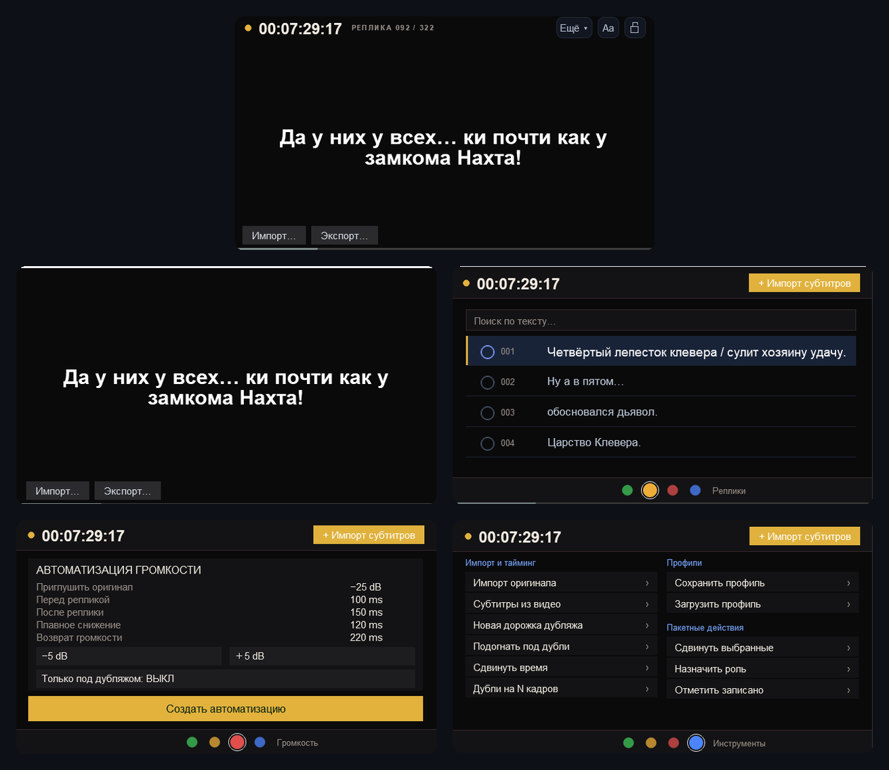

# Dubbing System

REAPER scripts for dubbing: **Dubbing Prompter** (prompter, subtitle import, roles, takes) and **Dubbing SubOverlay** (subtitles over the video).

## Languages
The prompter interface is available in Russian, English, Japanese and Chinese. It follows your REAPER language pack automatically; you can change it in the **More** menu (restart the script after switching). The phone/tablet prompter page uses the same language.

## Install
**Windows installer** (scripts, fonts and optional REAPER theme: keep current / gray / black): download the `.exe` from [Releases](https://github.com/zaraki999kenpachi/DubbingSystem/releases/latest).

## Install with ReaPack
1. Extensions → ReaPack → Import repositories…
2. Paste: `https://raw.githubusercontent.com/zaraki999kenpachi/DubbingSystem/main/index.xml`
3. Extensions → ReaPack → Browse packages → search "Dubbing".

Subtitles embedded in MKV/MP4 need ffmpeg and ffprobe (in `Scripts/Dubbing System` or on PATH). The video overlay needs ReaImGui and js_ReaScriptAPI.

## License
MIT, see [LICENSE](LICENSE). Free to use, modify and share.

## Android app
A small WebView app that opens the phone/tablet prompter page served by REAPER (`http://IP:8080/prompter.html`) in full screen. Download `DubbingPrompter.apk` from the [latest release](../../releases/latest) and allow "install from unknown sources" on the phone to install it.
